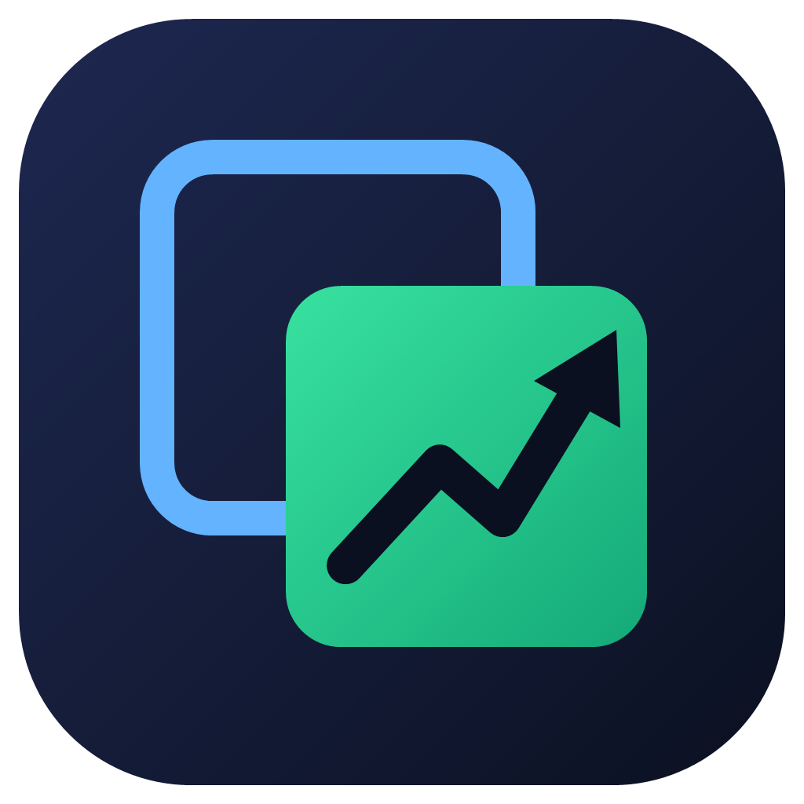
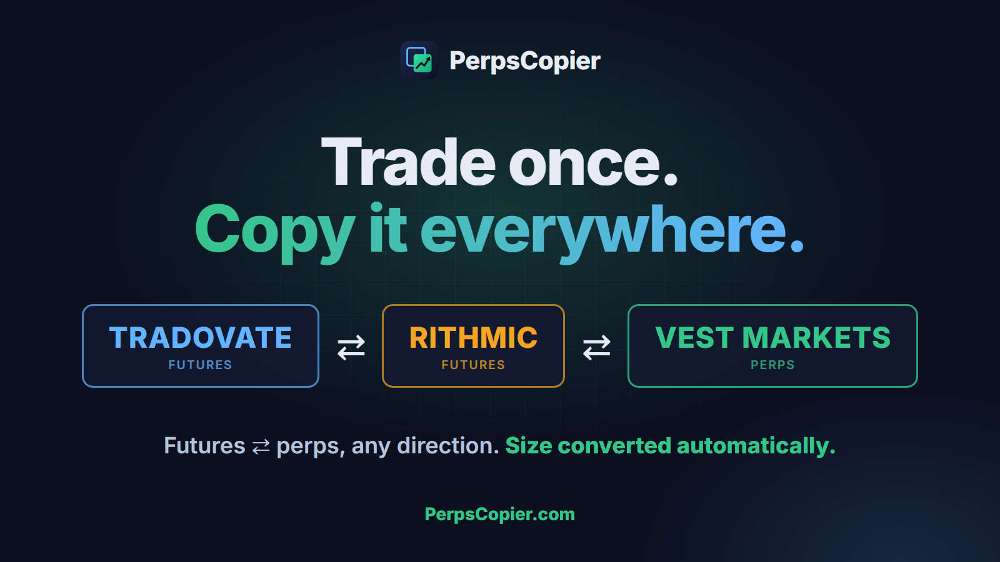
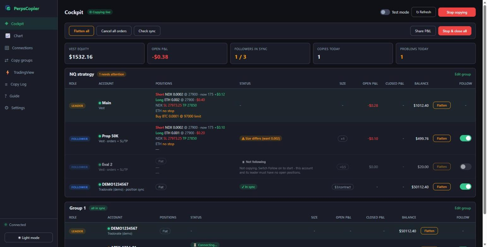
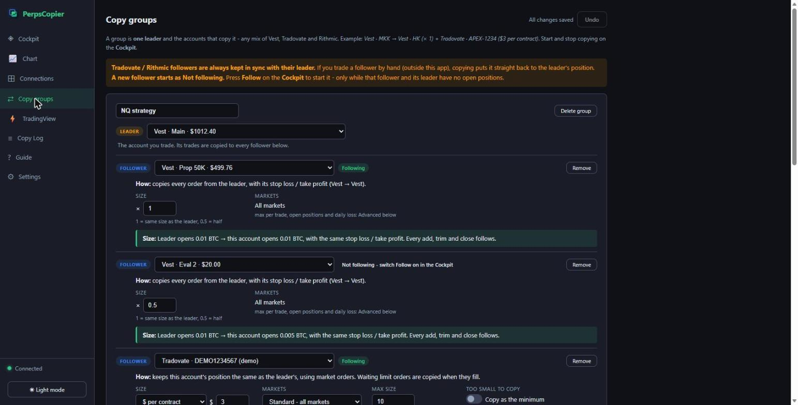
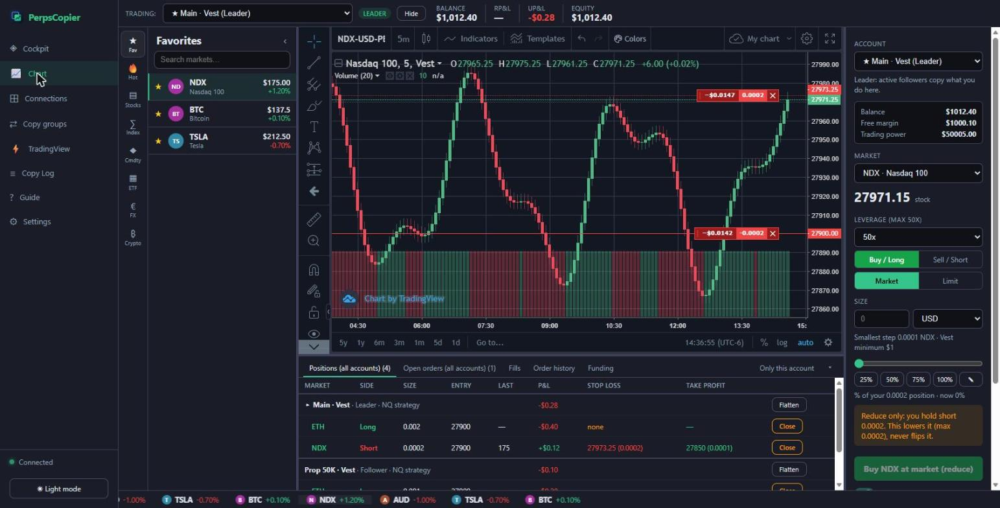

# PerpsCopier: Vest trade copier for perps and futures

**[PerpsCopier](https://perpscopier.com/)** is a Windows trade copier for **Vest Markets perps** (including **Vest Capital** accounts), **Tradovate** futures and **Rithmic** futures (including TradeSea firms). You trade one leader account and every follower account copies it, each at its own size.

**Free during beta.** [Download for Windows](https://perpscopier.com/download/PerpsCopier-Setup.exe) · [Microsoft Store](https://apps.microsoft.com/detail/XP9C95JGG768QZ) · [Setup guide](https://perpscopier.com/guide.html)

> This repository hosts documentation and the public issue tracker. The app itself is closed source.

## What it copies

| From → To | What is copied |
|---|---|
| **Vest → Vest** | Entries, adds, closes, reversals, stop loss, take profit and leverage. Follower size is a ratio (x0.5, x1, x2). |
| **Vest → futures** | NDX → MNQ, SPX → MES, gold → MGC and more, sized by dollar exposure (10 NDX = 5 MNQ) or a fixed dollar amount per contract. |
| **Futures → Vest** | NQ/MNQ → NDX, ES/MES → SPX, from Tradovate, Rithmic or TradeSea. |
| **Futures → futures** | Tradovate ↔ Rithmic, any mix of prop firm, evaluation, live and demo accounts. |
| **TradingView → Vest** | A private webhook URL trades your Vest leader, and every follower copies it. |

## Features

- **Copy groups:** one leader, any number of followers, any mix of platforms.
- **Test mode:** nothing is sent. The Copy Log shows exactly what would have been copied before you go live.
- **Risk limits:** Vest → Vest groups can cap dollars per trade, open positions and daily loss; futures followers have a maximum size per market.
- **Secure logins:** Vest uses its own email code login, Tradovate uses its own login page, and Rithmic uses the credentials your firm gave you. PerpsCopier never sees your Tradovate password.
- **Trade from the chart:** Vest and Tradovate / Rithmic futures, with each account's positions, orders, stops and P&L.
- **Plain-word alerts:** the Copy Log and the Cockpit say what happened and what to do, for example when a broker refuses an order.
- **Share your P&L:** make an image of today's P&L for one account or all of them.
- **Works with prop firms:** Vest Capital, Apex Trader Funding, TradeSea firms and other Tradovate or Rithmic firms.

## Screenshots

The **Cockpit**: every copy group, each account's positions, stops, open P&L and whether each follower is in sync.

**Copy groups**: one leader, any mix of followers, with the size for each follower explained in plain words.

**Chart**: trade Vest and Tradovate / Rithmic futures from the chart, with every account's positions and orders below.

Screenshots use sample accounts and prices.

## Get started

1. Install PerpsCopier from the [Microsoft Store](https://apps.microsoft.com/detail/XP9C95JGG768QZ) or the [website](https://perpscopier.com/) (Windows 10 and 11; Mac coming soon).
2. Create your PerpsCopier account in the app.
3. Connect Vest, Tradovate or Rithmic on the Connections page.
4. Make a copy group, pick a leader and followers, and set each follower's size.
5. Run it in Test mode, then go live.

The full walkthrough is in the [guide](https://perpscopier.com/guide.html).

## Documentation

Full documentation is in [docs/](docs/README.md) and on [perpscopier.com/docs](https://perpscopier.com/docs/):

- [Getting started](docs/getting-started.md) · [Connecting accounts](docs/connecting-accounts.md) · [Copy groups](docs/copy-groups.md) · [What gets copied](docs/what-gets-copied.md)
- [Risk limits](docs/risk-limits.md) · [TradingView webhook](docs/tradingview-webhook.md) · [Chart trading](docs/chart-trading.md) · [Copy Log and alerts](docs/copy-log-and-alerts.md)
- [Settings](docs/settings.md) · [Billing](docs/billing.md) · [Updates](docs/updates.md) · [Troubleshooting](docs/troubleshooting.md) · [FAQ](docs/faq.md)

## Updates

The app updates itself in the background. Every version is listed under [releases](../../releases).

## Learn more

- [Vest trade copier (Vest to Vest)](https://perpscopier.com/vest-trade-copier.html)
- [Vest Capital copy trading](https://perpscopier.com/vest-capital-copy-trading.html)
- [Copy Vest perps to Tradovate and Rithmic](https://perpscopier.com/copy-vest-perps-to-futures.html)
- [Copy futures trades to Vest](https://perpscopier.com/copy-futures-to-vest.html)
- [Tradovate and Rithmic trade copier](https://perpscopier.com/tradovate-rithmic-trade-copier.html)
- [TradingView alerts to Vest](https://perpscopier.com/tradingview-alerts.html)
- [Best Vest trade copier: comparison](https://perpscopier.com/best-vest-trade-copier.html)

## Support

To report a bug or request a feature, open an [issue](../../issues) or email support@perpscopier.com.
Follow us on [X](https://x.com/perpscopier) and [Instagram](https://www.instagram.com/perpscopier/).

---

PerpsCopier is not affiliated with Vest Markets, Tradovate or Rithmic. Trading carries risk, and copied trades may fill at slightly different prices than the leader's.
