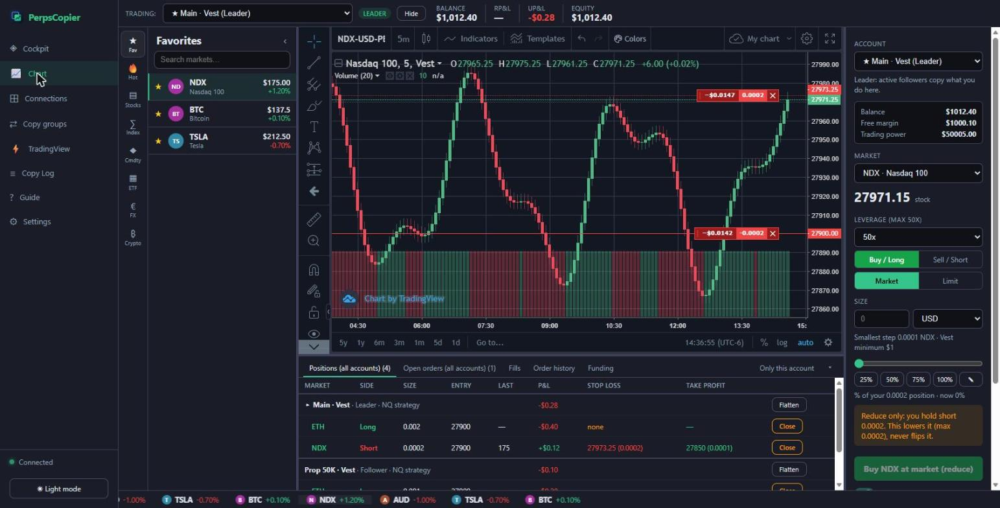

# Chart trading

The **Chart** page lets you trade Vest perps and Tradovate / Rithmic futures from a TradingView-style chart. Below the chart you see each account's positions and orders.

> **Trading a leader here is copied to its followers.** The ticket tells you the role of the account you picked:
>
> - **Leader**: active followers copy what you do here.
> - **Follower**: while copying is on, it is held to its leader. Switch its Follow off on the Cockpit before trading it by hand.
> - **Not in a copy group**: nothing here is copied.

## Vest markets

Vest markets have Vest candles. The order ticket on the right has:

| Field | What it does |
|---|---|
| **Account** | The Vest account to trade, with its **Balance**, **Free margin** and **Trading power** |
| **Market** | The Vest market |
| **Leverage** | Applies as soon as you pick it (up to the market's max) |
| **Buy / Long**, **Sell / Short** | The side |
| **Market**, **Limit** | The order type. For Limit, type the price or drag the line. |
| **Size** | In USD, in the market's own unit, or, for index and commodity markets, in futures contract sizes (for example NQ or MNQ contracts for NDX) |
| Size slider and % buttons | A % of your trading power, or a % of your position when reducing. Press ✎ to edit the % buttons. |
| **Stop loss**, **Take profit** | Optional. Type a price or drag the line on the chart. |
| **Ask before sending** | Ask you to confirm each order |

The line under Size shows the order in the market's unit, its dollar value and the margin it needs. If the size is under the smallest order, the ticket says so and offers **Use …** for the minimum. Vest's minimum order is $1.

If you already hold a position and send the other side, the ticket shows **Reduce only**: it lowers the position and never flips it.

## Futures markets (Tradovate and Rithmic)

Futures (NQ, ES, CL, GC…) appear on the Chart once a Rithmic login has **Use for chart data** ticked on **Connections**. Pick a futures market. The ticket sends orders to the **Tradovate or Rithmic account you pick there**, whichever login the candles come from.

| Field | What it does |
|---|---|
| **Account** | The Tradovate or Rithmic account, with its **Balance** and **Open P&L** |
| **Buy**, **Sell** | The side |
| **Market**, **Limit**, **Stop** | The order type. For Limit and Stop, type the price or drag the line. |
| **Contracts** | Whole contracts, with 1 / 2 / 5 / 10 quick buttons |
| **Stop loss**, **Take profit** | Optional. The broker holds them and places them when the entry fills. |
| **Ask before sending** | Ask you to confirm each order |

**Close** cancels that market's working orders first, its stop and target included, so nothing is left behind that could open a new position. Then it closes the position at market.

## On the chart

- Your position and working orders are drawn on the chart.
- **Drag** an order, stop or target to move it.
- **Drag the position line** up or down to set a stop loss (loss side) or take profit (profit side).
- **X** on an order cancels it. **X** on the position closes it at market.
- **Right-click** a price for a buy, sell, stop or target order at that price.

## The panel under the chart

The bottom panel shows open positions for every Vest, Tradovate and Rithmic account (or only the account you are trading), plus the selected account's working orders. For Vest accounts it also shows fills, order history and funding.

Each row has **Close** (one position) or **Flatten** (cancel the account's working orders and close all its positions at market) and **Cancel** for orders.

Flattening a leader closes its followers' positions too, because copying stays on.
