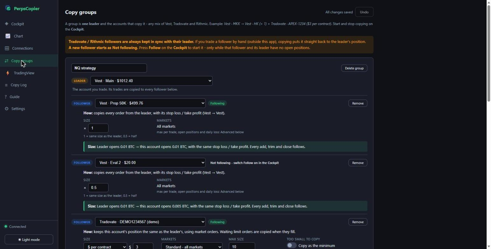

# Copy groups and sizing

A **copy group** is one **leader** and the accounts that copy it, the **followers**. Followers can be any mix of Vest, Tradovate and Rithmic accounts. You set groups up on the **Copy groups** page, and start and stop copying on the **Cockpit**.

## Create a group

1. Press **+ New group** and give it a name, for example "NQ strategy".
2. Pick the **Leader**: the account you trade yourself.
3. Press **+ Add follower** and pick an account. Repeat for each follower.
4. For each follower choose **Size**, and for futures-style followers also **Markets**, **Max size** and **Too small to copy**. The green box under each follower shows a worked example for its own settings.
5. Changes save by themselves about a second after you make them. The top of the page says **All changes saved**.

Notes:

- A group that is not finished, such as a follower row with no account picked, is saved once it is complete. The page says **Not saved yet: finish the group below** until then.
- **Undo** goes back to the last saved setup.
- **Remove** takes one follower out. Deleting the whole group asks you to confirm.
- If you pick an account that followed somewhere before, its old size settings come back.

## Rules

| Rule | Why |
|---|---|
| Every group needs a name, and names must be different. | So you can tell groups apart. |
| An account can follow **only one** leader. | One account can't be held to two leaders. |
| An account can't follow itself, or be listed twice in a group. | |
| Each leader can lead only one group. Put all its followers in one group. | |
| Only **one** group can copy **Vest → Vest**. | The Vest → Vest copier has one leader. Groups with Tradovate or Rithmic followers have no such limit. |
| Every follower needs a size above 0. | |

## Two ways of copying

Each follower row says **how** it is copied:

| Leader → follower | How it is copied |
|---|---|
| **Vest → Vest** | Every order is copied, with its stop loss / take profit. Leverage matches the leader. |
| **Anything with Tradovate or Rithmic** (Vest → futures, futures → Vest, futures → futures) | The follower's **position** is kept the same as the leader's, using market orders. Entries, adds, trims, reversals and exits (including the leader's stop or target filling) are all copied. Waiting limit orders are copied when they fill. |

See [What gets copied](what-gets-copied.md) for the full table.

## Following and Not following

Tradovate and Rithmic followers are **always kept in sync** with their leader while their **Follow** switch is on.

- A new follower starts as **Not following**. On the **Cockpit**, switch its **Follow** on.
- Follow only switches on while that follower and its leader have **no open positions**.
- To trade a follower yourself, switch its **Follow** off first. While Follow is on, a Tradovate / Rithmic follower, or a Vest follower of a futures leader, is held to the leader's position in the copied markets. (Vest → Vest followers copy orders and are not held.)
- Markets that are not mapped in the group are left alone.

## Size

Size decides how big each follower's position is compared with the leader's. Sizes are always **rounded down**, so a follower never holds more than you asked for.

| Size setting | Where | What it means | Example |
|---|---|---|---|
| **× ratio** | Vest → Vest | A share of the leader's size. 1 = same, 0.5 = half, 2 = double. | Leader opens 0.01 BTC, × 0.5 → follower opens 0.005 BTC |
| **Same size ×** | Any group with futures | The same **dollar size** as the leader, times the number. | 10 NDX on Vest = 5 MNQ (1 MNQ is $2 a point). 1 NQ = 10 MNQ |
| **$ per contract** | Vest ↔ futures only | Each futures contract equals this many dollars of Vest position. | At $3: leader holds $10.20 of NDX on Vest → follower holds 3 MNQ. Leader holds 2 MNQ → follower holds $6 of NDX on Vest |

For futures → futures followers the size is a plain **×** number: the same dollar size times the number.

### How "Same size ×" is worked out

Every market has a **point value**: the dollars gained per 1.0 move in price for one unit. Vest perps are 1 unit = $1 per point. The follower size is:

> follower size = leader size × leader point value ÷ follower point value × your number, rounded down

So 10 NDX × $1 ÷ $2 (MNQ) × 1 = 5 MNQ.

Futures point values the app uses:

| Contract | $ per point | Micro | $ per point |
|---|---|---|---|
| ES (S&P 500) | 50 | MES | 5 |
| NQ (Nasdaq 100) | 20 | MNQ | 2 |
| YM (Dow) | 5 | MYM | 0.5 |
| RTY (Russell 2000) | 50 | M2K | 5 |
| GC (Gold) | 100 | MGC | 10 |
| SI (Silver) | 5,000 | SIL | 1,000 |
| HG (Copper) | 25,000 | MHG | 2,500 |
| PL (Platinum) | 50 | - | - |
| CL (Crude oil) | 1,000 | MCL | 100 |
| NG (Natural gas) | 10,000 | - | - |
| 6E (Euro) | 125,000 | M6E | 12,500 |
| 6B (British pound) | 62,500 | M6B | 6,250 |
| 6A (Australian dollar) | 100,000 | M6A | 10,000 |
| BTC (Bitcoin) | 5 | MBT | 0.1 |
| ETH (Ether) | 50 | MET | 0.1 |

A futures market that is not in this list is not copied: the app refuses to size a contract it does not know.

### How "$ per contract" is worked out

- **Vest leader → futures follower:** contracts = (leader's Vest position × Vest price) ÷ your $ amount, rounded down.
- **Futures leader → Vest follower:** Vest size = contracts × your $ amount ÷ Vest price, rounded down to Vest's size step. If that is under Vest's $1 minimum order, it is raised to the minimum.

The $ amount is applied when the leader trades. It does not change as the price moves, so a price move alone never sends orders. When you switch a follower to **$ per contract**, it starts at $3.

### Own size per market

Choose **Markets → Custom**, then type a number next to a market: how many this account holds for each 1 the leader holds.

Example: ES → MES **3** and NQ → MNQ **2** means 1 ES copies as 3 MES and 1 NQ copies as 2 MNQ (2 ES = 6 MES). Markets left empty use the Size. Max size and rounding down still apply.

### Max size

**Max size** caps a futures-style follower per market. For example, 4 = never more than 4 contracts (or 4 Vest units for a Vest follower) per market, however big the leader's position. Leave it empty for no limit.

### Too small to copy

When the leader's position is smaller than one contract (or Vest's smallest order) for this follower, it is **skipped**, and the Copy Log says so. Tick **Copy as the minimum** to hold the smallest size instead (1 contract, or Vest's minimum).

Vest's smallest NDX order is 0.0001 NDX (about $2.80). Vest also refuses orders under $1.

## Markets and symbol mapping

**Markets** decides which of the leader's markets a follower copies, and which market each one becomes.

- **Standard - all markets** (default): every market with a standard pair is copied.
- **Custom - choose markets**: a checklist opens. Untick a market to stop copying it. Use the menu next to it to copy it as a different market, for example Nasdaq as NQ instead of MNQ. At least one market must stay ticked.

Vest → Vest copies all markets. There is no market choice.

### Vest → futures (standard pairs)

Vest → futures uses the **micro** contracts where one exists.

| Vest market | Futures follower |
|---|---|
| NDX (Nasdaq 100) | MNQ |
| SPX (S&P 500) | MES |
| YM (Dow) | MYM |
| RTY (Russell 2000) | M2K |
| GC (Gold) | MGC |
| SI (Silver) | SIL |
| HG (Copper) | MHG |
| PL (Platinum) | PL |
| CL (Crude oil) | MCL |
| NG (Natural gas) | NG |
| EUR (Euro) | M6E |
| GBP (British pound) | M6B |
| AUD (Australian dollar) | M6A |
| BTC (Bitcoin) | MBT |
| ETH (Ether) | MET |

### Futures → Vest (standard pairs)

| Futures leader | Vest follower |
|---|---|
| NQ, MNQ | NDX |
| ES, MES | SPX |
| YM, MYM | YM |
| RTY, M2K | RTY |
| GC, MGC | GC |
| SI, SIL | SI |
| HG, MHG | HG |
| PL | PL |
| CL, MCL | CL |
| NG | NG |
| 6E, M6E | EUR |
| 6B, M6B | GBP |
| 6A, M6A | AUD |
| BTC, MBT | BTC |
| ETH, MET | ETH |

When two leader contracts map to the same Vest market (for example NQ and MNQ → NDX), their dollar sizes are added up first, then sized and rounded once.

### Futures → futures

The follower keeps the **same contract**: NQ → NQ, MES → MES. Use **Custom** to copy into a different contract, for example NQ → MNQ, and the Size or a per-market size to set the amount.

## Worked examples

### Example 1: copy one Vest account to another

- Group "Vest main": leader **Vest · Main**, follower **Vest · Prop 50K**, size **× 1**.
- You open a BTC long with a stop loss on Main → Prop 50K opens the same size with the same stop loss.
- You move the stop or close → Prop 50K does the same.

### Example 2: copy Vest to a Tradovate prop account

- Group "NQ to prop": leader **Vest · Main**, follower **Tradovate · APEX-1234**, size **$ per contract, $50**, Max size **3**.
- You buy $120 of NDX on Vest → the Tradovate account buys 2 MNQ ($120 ÷ $50 = 2.4, rounded down).
- You close on Vest → the Tradovate account sells its 2 MNQ.

### Example 3: copy one futures account to several prop accounts

- Group "Apex copies": leader **Tradovate · main account**, followers **Rithmic · Apex-1**, **Rithmic · Apex-2**, **Tradovate · TPT-1**, each **× 1**.
- You buy 2 NQ on the leader → each follower buys 2 NQ at the same moment.
- Your stop fills on the leader → each follower is flattened with a market order.

## See also

- [What gets copied](what-gets-copied.md)
- [Risk limits and safety](risk-limits.md)
