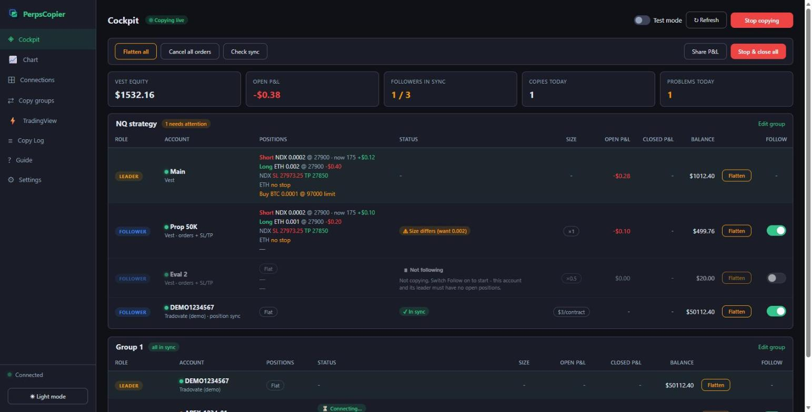

# Copy Log and alerts

PerpsCopier tells you what it did in three places: the **Copy Log**, the **Cockpit**, and **desktop notifications**.

## The Copy Log

The **Copy Log** lists everything the app did: each copy, each skipped copy and why, connections, and errors. It is written in plain words, for example "Leader opened long 0.01 BTC", "Copied to Prop 50K: … in 0.12s" or "Not copied to …: …".

### Terminal and List views

Switch between two views at the top of the page. The app remembers your choice.

| View | What it looks like |
|---|---|
| **Terminal** (default) | A console: oldest at the top, newest at the bottom. It scrolls with new lines unless you scroll up. A badge shows the state: **COPYING**, **TEST MODE**, **PAUSED** or **STOPPED**. Each line is tagged **LEADER**, **SYSTEM**, or **→ Vest / → Tradovate / → Rithmic** for the follower's platform, and marked ✓ (copied), ! (warning) or ✕ (error). |
| **List** | Newest first, with a coloured dot per line: green trade, amber warning, red error, grey system. |

Click a line to see its raw detail.

### Filters, search and export

| Control | What it does |
|---|---|
| **Trades** | Copies, leader trades and errors (default) |
| **Problems** | Warnings, errors and skipped copies |
| **Everything** | All lines, including connections and system notes |
| **Search…** | Shows only lines containing your text |
| **Export CSV** | Saves the log as a CSV file |

### Common lines

| You see | It means |
|---|---|
| `sync_order` | A Tradovate / Rithmic-style follower was brought to the leader's position (with the order sent) |
| `dry_would_sync`, "Dry run - would …" | Test mode: what would have been sent. Nothing was sent. |
| `sync_not_copied`, "not copied" | Too small for this follower's size, so skipped. See **Too small to copy**. |
| `copy_opened`, `copy_closed`, … | Vest → Vest copies |
| "Size capped on …" | A Vest → Vest copy was cut down by **Max per trade** |
| "Not copied to …" | A copy was skipped, with the reason |
| "Copying paused: …" | Vest → Vest copying paused (see [Risk limits](risk-limits.md#vest--vest-pauses)) |
| "TradingView: …" | A TradingView signal and its result |
| "Chart: …" | An order you placed from the Chart |

To view the reason a broker refused an order, open the line. The broker's own words are shown in quotes.

The Copy Log is kept on your computer only. **Settings → Open data folder** opens the folder.

## The Cockpit

The **Cockpit** shows one card per copy group: the **leader** on top and its **followers** under it. The card's heading says "all in sync" or how many followers need attention.

| Column | What it shows |
|---|---|
| Dot | The account's connection: green connected, amber reconnecting, red down |
| **Positions** | What the account holds now (for Vest also its stops and waiting orders) |
| **Status** | How the follower is doing, in words. The line under it gives the detail. |
| **Size** | The follower's size setting |
| **Open P&L**, **Closed P&L**, **Balance** | Today's money. Closed P&L is after commissions when the broker gives them. |
| **Follow** switch | Starts or stops one follower |

At the top: **Start / Stop copying**, **Test mode**, **Flatten all**, **Cancel all orders** and **Check sync** (Vest → Vest group), **Share P&L**, and **Stop & close all**.

### Follower statuses

| Status | What it means | What to do |
|---|---|---|
| ✓ In sync | The follower holds what it should. | Nothing. |
| ⏳ Copying | An order was just sent; waiting for the fill. | Nothing - it clears in a second or two. |
| ⏳ Connecting… | Connecting to the broker, or loading positions. | Nothing - copying starts by itself. |
| 🧪 Test mode | What would have been sent (nothing is sent). | Turn Test mode off to copy for real. |
| ⚠ Too small | The leader's position is smaller than one contract (or Vest's smallest order) for this follower. | Raise the size, or turn on **Copy as the minimum**. |
| ⏸ Market closed | The futures market is closed (daily break or weekend). | Nothing - it copies when the market opens. |
| ⚠ Disconnected | The leader's or follower's connection is down; nothing is sent meanwhile. | Check **Connections**. |
| ⚠ Out of sync | The follower has held the wrong position for a while. The detail says what it holds and what it should hold. | Read the detail and the Copy Log. |
| ✕ Error | An order failed, was refused, or did not fill. Copying carries on: this market tries again by itself (the account is checked first, so nothing is doubled). | Usually nothing. If it keeps saying "Account refused orders", fix the account with your broker or prop firm. |
| ⏸ Not following | Follow is off for this follower. | Switch Follow on (follower and leader must be flat). |
| ⛔ Stopped following | The app switched Follow off, for example because one market kept getting undone. The reason and time are shown. | Fix the cause, then switch Follow on. |
| ⏸ Paused / Copying off | Copying is paused (it turns back on by itself) or stopped. | Press **Start copying** if it is stopped. |
| ⚠ Size differs (Vest → Vest) | A Vest follower's size does not match the leader × ratio. | Press **Check sync**; flatten or adjust by hand if needed. |

**Check sync** compares the Vest leader with its Vest followers and says whether every copy matches.

## Desktop notifications

PerpsCopier shows a Windows notification when:

- A copy **error** happens.
- A follower stays **out of sync** for about 15 seconds, or holds a position its leader doesn't. Another notification says when it is **back in sync**.
- A **broker connection** goes down, and when it is back.
- Copying **pauses** or **resumes** by itself.
- You press the emergency stop (**Ctrl+Shift+K**).
- An **update** is ready.

## Sounds

**Settings → Sounds → Fill sound** plays a sound when any of your accounts gets a fill. A buy sounds a little higher than a sell. A trade and its copies play once.
